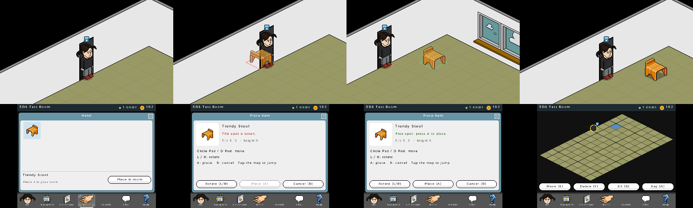
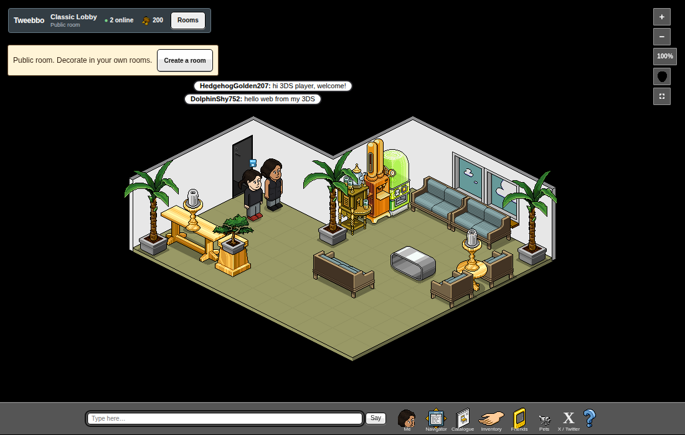
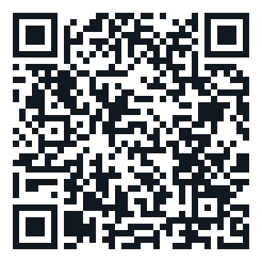

# Tweebbo for Nintendo 3DS

Native Nintendo 3DS client for [Tweebbo](https://tweebbo.lol) (C + libctru + citro2d + mbedTLS). It plays **in the same hotel as tweebbo.lol**: the same rooms, characters, credits, inventory, friends and pets as the web, the X player and PC. The top screen shows the room at native resolution (64×32 tiles, like the web) and the bottom screen is the classic interface of the web edition, adapted to touch and buttons.

> Tweebbo is in development and may be unstable.




## Download

Latest version: **[releases](https://github.com/Tweebbo/tweebbo-3ds/releases/latest)**. On the console: FBI → *Remote Install* → *Scan QR Code*:



The QR code points to `https://github.com/Tweebbo/tweebbo-3ds/releases/latest/download/tweebbo.cia` (always the latest version). After that, Tweebbo updates itself from inside the game.

A console with custom firmware (Luma3DS) is required. `tweebbo.3dsx` works from the Homebrew Launcher (`sdmc:/3ds/tweebbo.3dsx`).

## Features

- **Online**: WebSocket over TLS (mbedTLS, embedded root certificates) on its own thread, with exponential reconnection, renewal before Vercel's 270 s limit and session recovery. HELLO carries platform byte `1` (Nintendo 3DS): the web shows a small pixel-art handheld over the player and their profile reads "This person is connected through a Nintendo 3DS system". The 3DS shows it over other console players too.
- **The same features as the web**:
  - *Navigator*: All / Public / My Rooms with occupancy, *Go*, refresh every 15 s and **Create a room**.
  - *Catalogue*: every page and offer of the catalogue, icons, prices and purchase confirmation.
  - *Hand*: grouped inventory and **place in room**.
  - **Build mode**: Circle Pad / D-Pad moves the ghost furniture (green when it fits, red when it does not, same rules as the web), L/R rotate, A places, B cancels; wall items slide along the wall and L/R lower or raise them. Tapping the minimap jumps to that tile.
  - Furniture panel: sit or lie down, use (switches, dice, teleporters, gates), choose a drink at dispensers, move, rotate, pick up and redeem.
  - *Me*: gestures, drinks, the full wardrobe, renaming and **Save / restore character**.
  - *Friends Console*: friends with their room and *Visit*, requests, search, remove, ignore and private messages.
  - *Pets*: adopt (species, coat, color and name), place, commands and status; pets are drawn and walk in the room.
  - Rooms: the lobby, private rooms, Classic Park with its animated fountain and The Pool with swimming.
  - Chat bubbles, chat history, ignore list, hotel alerts and server notices.
- **"Press A" (3DS only)**: next to a dispenser, seat, bed, dice, switch, gate or teleporter (or facing another player) the top screen shows "Ⓐ Get a drink · Mochamaster", "Ⓐ Sit", "Ⓐ Roll the dice"… and A does it. With nothing nearby, A talks.
- **In-game updates**: when entering the hotel the game reads `latest.json` from the latest GitHub release. If there is a newer version it offers **Update now**, downloads the CIA (or the `.3dsx` when launched from the Homebrew Launcher), checks its SHA-256 and installs it through AM without FBI, then asks to restart. If the console refuses to install, the CIA is saved to `SD:/cias/` to install with FBI. Also available in *Help → Check for updates*.
- **Offline practice**: a local simulation of the lobby with bots, only when chosen in *Help → Offline*.

## Controls

| Control | Room | With a window open | Building |
| --- | --- | --- | --- |
| Circle Pad | Walk (8 directions) | Walk | Move the item |
| D-Pad | Walk | Move through lists, tabs and values | Move the item |
| A | Talk / "Press A" action | Main action | Place |
| B | Sit / stand up | Close the window | Cancel |
| X / Y | Wave / dance | Shortcuts (e.g. *Create a room*) | — |
| L / R | Overview | Overview | Rotate (lower/raise on walls) |
| SELECT | Next window | Next window | — |
| START | Quit | Quit | Quit |

Touch screen: bottom bar (Me, Navigator, Catalogue, Hand, Friends, Chat, Help), lists that scroll by dragging, and the minimap (tap to walk, sit or select people and furniture).

## Saved progress

Everything done on the console (credits, inventory, rooms, looks, name, friends, pets) is saved on the server, exactly like the web. The console only keeps the character key (`sdmc:/3ds/Tweebbo/token-<server>.txt`, **private**) and the last room, so reopening, updating or reinstalling keeps the same character. If the SD card is lost, *Me → Save / restore character* recovers the character with its private code (also from the web).

## Performance and compatibility

Tested on real hardware. Runs on Old 3DS, Old 2DS, New 3DS and New 2DS XL; in Old 3DS memory mode 26 MB of linear memory stay free after loading the graphics, with a 16 MB budget for furniture.

- Grey avatar parts are stored as LA8 (half the memory) and only the interface graphics in use are packed: the atlas takes about 3.3 MB.
- Caches for parsed text and avatar compositions avoid hundreds of lookups per frame, which matters most on the 268 MHz Old 3DS CPU.
- Furniture loads per room with an LRU cache; backgrounds, scenes and pets are freed when leaving.
- New 3DS runs in 804 MHz mode.
- `sdmc:/3ds/Tweebbo/log.txt` records the console model, free memory, texture failures, updates and, every 30 s, the average frame time.

## Server

The default server is `wss://tweebbo.lol`. For testing against another server: build with `TWEEBBO_SERVER=ws://<host>:<port> ./build.sh cia`, or on the console *Help → Local server…*. *Help → Check tweebbo.lol* tests the secure connection (GET `/healthz`, creates no data). Files in `sdmc:/3ds/Tweebbo/`: `server.txt`, `room.txt`, `token-<server>.txt`, `last-error.txt`, `log.txt`, and optionally `update-url.txt` to read updates from another manifest.

## Building

Requirements: Podman, Node 22, Python 3 with Pillow, Google Chrome (for the graphics export) and a checkout of the Tweebbo web edition (`TWEEBBO_WEB`).

```bash
./build.sh export   # exports graphics and data from the web edition and generates source/gen/assets.c
./build.sh brand    # redraws the HOME Menu icon, banner and banner sound with the game's avatars
./build.sh          # converts textures (tex3ds, compressed) and builds out/tweebbo.3dsx
./build.sh cia      # also packs out/tweebbo.cia (version from VERSION)
NOTES="…" ./build.sh release   # publishes the GitHub release (CIA, 3DSX, latest.json, QR code)
make -C tests                  # simulation, protocol, state, every furniture graphic and animations
make -C tests online           # real online client against ws://127.0.0.1:8092 (creates a guest)
make -C tests tls              # TLS with mbedTLS 2.28 against https://tweebbo.lol/healthz
```

When changing `TWEEBBO_SERVER`, touch `source/net.c` and `source/ui.c` (make does not track compiler options). `./build.sh release` refuses to publish a CIA that points to a local server.

### Graphics shared with the web

`tools/export/run.mjs` copies a snapshot of the web client and runs its own drawing code in headless Chrome: avatar parts, swimming bodies, all 890 catalogue furniture items (every rotation, state and animation frame), the floors of rooms without an original background (`Renderer.buildFloor`), plus the catalogue, public rooms, pets and classic interface data. `tools/pack.py` converts it for the console:

- Avatar and classic interface atlas (`romfs:/gfx/atlas*.t3x`, RGBA8 and LA8 pages).
- One texture per furniture item (`romfs:/furni/d<id>.t3x`), loaded on demand with an LRU cache sized to the free linear memory.
- Room backgrounds, layered park and pool scenes, and one texture per pet breed palette.
- C tables: catalogue and offers, wardrobe, dances, drinks, pets and rooms.

## Emulator tests

`tools/emu/` runs Azahar headless (Xvfb + xdotool); see [tools/emu/README.md](tools/emu/README.md). With `NET=host` the emulator reaches a server on the same machine.

## Layout

```
source/
  main.c        Main loop and SD card storage
  net.c         Network thread, queues, reconnection, rooms and HTTP requests (or the offline simulation)
  ws.c conn.c   WebSocket/HTTP over TCP with TLS (mbedTLS); also build on the PC
  certs.c       Root certificates for tweebbo.lol and GitHub
  update.c      In-game updates from GitHub releases
  world.c       Client state
  proto.c       Binary protocol v6 (+ platform byte in HELLO)
  scene.c       Top screen: camera, layers, depth, bubbles, ghost, 3DS badge, "Press A" prompt
  avatar.c      Avatars and swimmers
  pets.c        Pets
  build.c       Build mode (placement rules, walls)
  ui.c          Classic frame, room, chat, Me, wardrobe, help, alerts, updates, "Press A"
  ui_panels.c   Navigator, Catalogue, Hand, furniture panel, Pets
  ui_social.c   Friends Console
  skin.c        Windows, buttons and lists with the classic graphics
  gfx.c         Textures (atlas, on-demand furniture, scenes, pets) and text
  sim.c path.c  Offline simulated server
  gen/          Generated by tools/pack.py (not in the repository)
```
